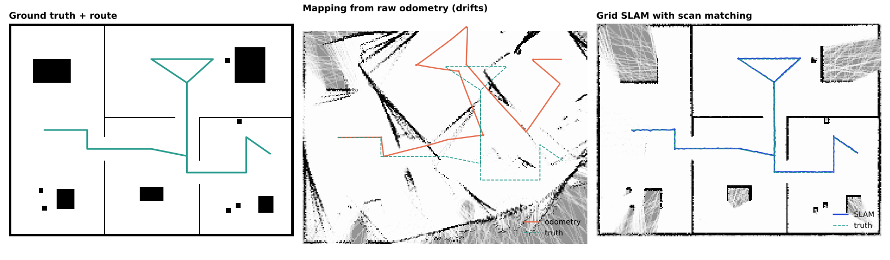
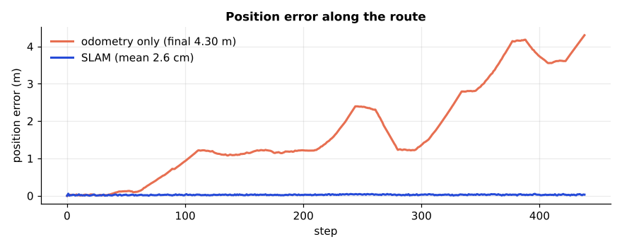
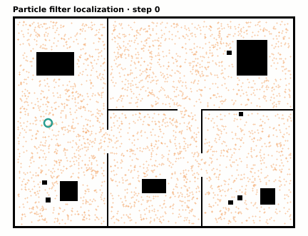
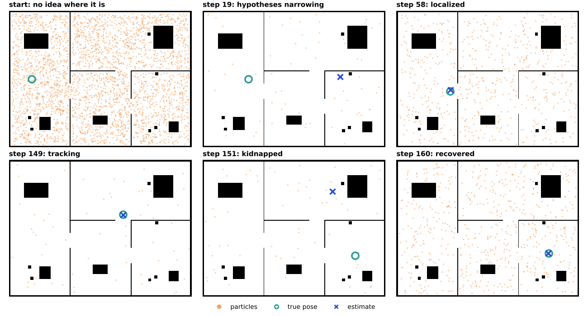

# 08 · SLAM and Monte Carlo localization

A robot with a 2D LiDAR **maps an unknown apartment while tracking its own position** (grid SLAM with correlative scan matching), and separately **finds itself on a known map from scratch**, including after being **kidnapped** (particle filter / Augmented MCL). Pure NumPy, so every step of the maths is visible.



Wheel odometry drifts **4.3 m** over the 440-step tour, so the map built from it (middle) is unusable. Matching each scan against the map built so far keeps the trajectory within **2.6 cm on average (max 5.6 cm)**, and the map comes out clean (right).



## Particle filter localization



3,000 particles start spread over the whole building. Look-alike rooms keep several hypotheses alive until the robot sees something distinctive, then the cloud collapses onto the true pose (**localized at step 57**, then tracking at about **1.5 cm**). At step 150 the robot is teleported 3.7 m without telling the filter. Augmented MCL notices the likelihood collapse, injects random particles, and **relocalizes within 6 steps**.



## How it works

| piece | file | idea |
|---|---|---|
| world + LiDAR | `slam/world.py` | occupancy-grid floor plan; vectorised ray marching (180 beams, 2 cm noise, dropouts) |
| motion model | `slam/world.py` | odometry (rot1, trans, rot2) with the α₁…α₄ noise model from *Probabilistic Robotics* |
| mapping | `slam/mapping.py` | log-odds inverse sensor model: free along each beam, occupied at the endpoint, clamped |
| sensor model | `slam/mapping.py` | **likelihood field**: chamfer distance transform, Gaussian on endpoint distance plus a random-measurement floor |
| localization | `slam/mcl.py` | predict → weight → low-variance resample when N_eff < N/2; **Augmented MCL** (w_slow / w_fast) for kidnap recovery; mode-of-mass estimate with hysteresis |
| SLAM | `slam/slam.py` | odometry guess → **coarse-to-fine correlative scan matching** (3 levels of 9×9×9) against the current map → insert scan |

## Bugs the tests caught

- **One noisy beam made a wall.** A single endpoint hit marked a cell occupied, walls thickened, every heading looked plausible, and the scan matcher drifted 1 rad. Walls now need two or more consistent hits.
- **The robot drove through furniture.** Randomly placed clutter landed on the route, so scans came from inside an obstacle. Clutter now keeps 60 cm from the route, and a test asserts at least 25 cm clearance along the whole tour.
- **"Best particle" after resampling is arbitrary.** All weights are equal after resampling, so the estimate jumped between clusters. It now uses the region with the most probability mass, with hysteresis.

## Run it

```bash
pip install -e ".[dev]"
pytest                 # 9 tests (~20 s)
python -m slam.viz     # regenerates every figure and the GIF in docs/
```

Tests cover: route clearance, ray-cast geometry, the distance transform, mapping accuracy with true poses, odometry noise bias, scan-matcher offset recovery, **SLAM beating odometry by 5× or more on two seeds**, and **global localization plus kidnap recovery that stays locked**.

## What I learned

Bayes filters · particle filters and resampling · occupancy grids and log-odds · likelihood-field sensor models · scan matching · why SLAM needs a map *and* a pose
